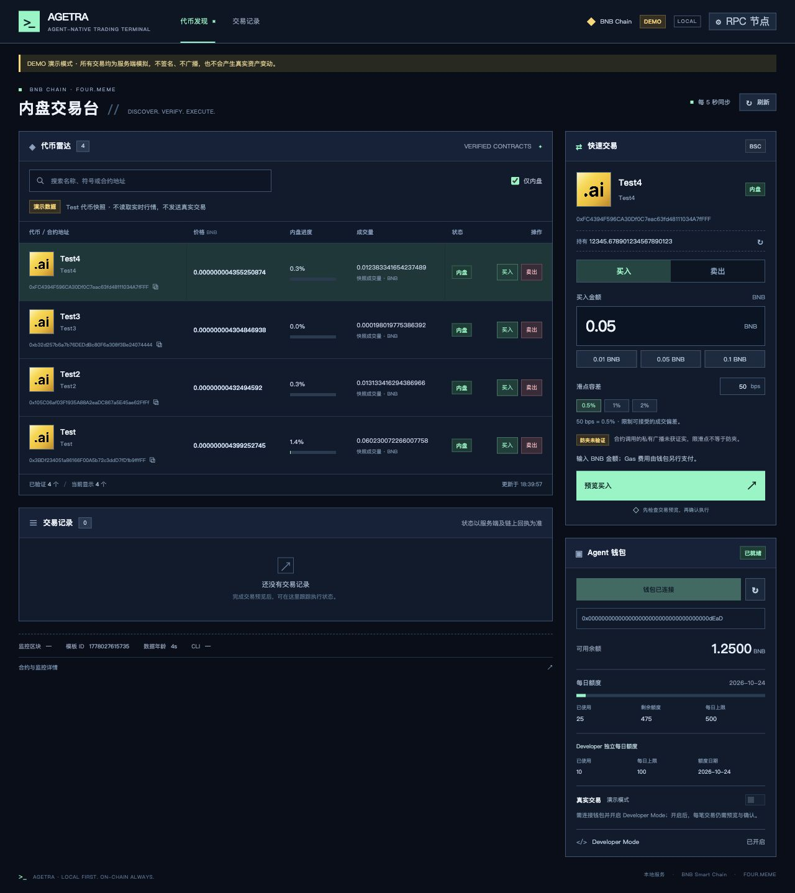
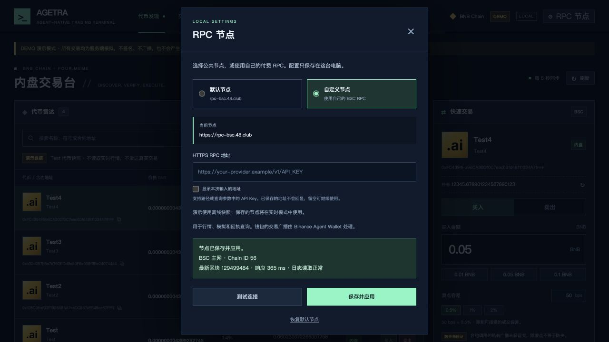

# Agetra Terminal

Agetra Terminal 是在本机运行的 Binance Agent Wallet 交易面板。

本版只展示并处理 BNB Smart Chain 上 **Binance Agent ID Exclusive 指定模板**的已核验代币；交易仅支持该模板的 WBNB 计价内盘。它不是 Four.meme 全站列表，代币毕业后的外盘交易尚未支持。

## 产品界面



*演示模式使用当前已获取的 Test、Test2、Test3、Test4 代币快照，展示代币雷达、快速交易和 Agent 钱包面板。*

## Windows 用户：下载后双击使用

从 [GitHub Releases](https://github.com/pearl4979/agetra-terminal/releases) 下载：

- `Agetra-Terminal-v0.2.4-Windows-x64.zip`：Windows x64 便携版，已内置 Node.js 和依赖。
- `SHA256SUMS.txt`：用于核对下载文件的 SHA-256。

不要选择 GitHub 自动生成的 Source code ZIP 来替代便携版。该便携包不适用于 macOS、Linux 或 Windows ARM64。

1. 将 ZIP **全部解压**到本机普通文件夹，例如 `C:\Agetra`。
2. 先双击 `演示.cmd`。浏览器会打开 `http://127.0.0.1:4319`，使用 Test 系列代币的离线快照、模拟余额和订单，不会发起链上交易。
3. 查看实时数据时，双击 `启动.cmd`，浏览器会打开 `http://127.0.0.1:4318`。
4. 保持运行窗口打开；关闭它会停止本地服务。只关闭浏览器不会停止服务。

每次通过便携启动器启动时，真实交易默认关闭。若浏览器没有自动打开，可手动访问上面的本机地址。不要直接在压缩包预览窗口内运行程序。

PowerShell 校验下载文件：

```powershell
Get-FileHash .\Agetra-Terminal-v0.2.4-Windows-x64.zip -Algorithm SHA256
```

将结果与同一 Release 的 `SHA256SUMS.txt` 对照。

## 钱包与使用范围

实时查看链上数据不需要连接钱包。需要使用钱包功能时，点击面板中的连接按钮，并在 Binance App 核对官方连接页面与配对码。预览自定义合约交易还要求有效的 Developer Mode、可用额度和足够余额，以 App 实际显示及钱包返回结果为准。

每笔执行都要先预览，再手动确认。卖出可能先需要一次精确数量授权，授权完成后必须重新预览卖出。出现 `UNKNOWN` 或等待 App 确认时，应先核对钱包和链上历史，不要连续重试或删除订单记录绕过阻塞。关闭程序不会撤销已经提交的交易。

程序仅监听本机地址。行情、模拟与交易回执通过 BSC RPC 读取，钱包预览和执行通过本机 Binance CLI 调用。终端没有已验证的私有广播或防夹通道。

更完整的操作与排错说明见 [使用教程](./使用教程.txt)。

## RPC 配置

默认使用 `https://rpc-bsc.48.club`。公共 RPC 可能限流或不可用；首次启动还可能需要补扫历史区块。

点击右上角 **RPC 节点**（手机上为齿轮按钮）：

1. 选择 **默认节点** 或 **自定义节点**；自定义节点填写 HTTPS RPC 地址，支持路径或查询参数中的 API Key。
2. 点击 **测试连接**，检查 BSC 主网（Chain ID 56）、最新区块和日志读取能力，并查看响应时间。
3. 点击 **保存并应用**，实时模式立即切换节点，无需重启。也可点击 **恢复默认节点**。



地址输入默认隐藏，已保存的 API Key 不会回显。配置保存在本机 `.runtime/rpc-settings.json`，重启后继续使用；演示模式保存的节点用于下次进入实时模式。节点切换会关闭真实交易开关并清除旧预览；存在未完成订单时，需先完成核对再切换。

从源码运行时也可使用 `.env` 中的 `BSC_RPC_URL`。界面保存的设置优先于环境变量；节点需要支持 `eth_getLogs` 及常规合约读取。

`.env` 和 `.runtime/rpc-settings.json` 可能包含你的 RPC 服务凭证，不要提交或转发。更换此 URL 改变的是终端读取与模拟通道，不能据此认定更换了 Binance 钱包的交易广播通道。

## 从源码运行

使用 Node.js 24；Windows 便携版固定使用 24.14.0。源码包不包含运行时或 `node_modules`。

```sh
npm ci --ignore-scripts
npm run demo
```

打开 `http://127.0.0.1:4319`。查看实时数据可运行 `npm start`；首次使用时保留 `.env.example` 中的 `ENABLE_LIVE_TRADING=false`。源码在其他系统上的兼容性尚未作为本版本的发布保证。

本地模拟测试：

```sh
npm test
```

仓库提供 Windows / Node.js 24.14.0 的测试 workflow，使用模拟钱包、模拟链上响应及本地 HTTP 服务，不配置钱包会话或交易凭证，不运行 `verify:chain`。测试结果以对应提交的 [Actions 记录](https://github.com/pearl4979/agetra-terminal/actions) 为准；配置 workflow 本身不代表测试已通过。

Windows 自动化验证包含 99 项测试，覆盖便携启动器、重复启动、端口冲突及模拟交易流程。具体结果见 [Actions 记录](https://github.com/pearl4979/agetra-terminal/actions)。

## 维护者打包

Python 3.9 或更高版本的标准库即可打包，不运行应用代码，也不连接钱包：

```sh
python scripts/package-release.py
```

脚本读取并核对 `package.json` 与 `package-lock.json` 的名称、版本，只收录指定的项目文件。默认在 `dist/` 生成：

- `Agetra-Terminal-v0.2.4-Windows-x64.zip`
- `Agetra-Terminal-v0.2.4-Source.zip`
- `SHA256SUMS.txt`

便携包需要完整的 Windows `runtime/` 和原依赖树；它们只进入 Windows 包，保留原始许可文件。干净源码 checkout 可运行 `python scripts/package-release.py --source-only`，仅生成源码包及本次输出的校验文件。打包器会排除 `.env`、`.runtime`、Git 元数据和临时输出，并拒绝白名单目录中的符号链接。打包成功不等于 Windows 启动或真实交易验证成功。

转发时使用干净发布包。不要重新打包自己运行过的目录，也不要分享钱包会话、配对信息或订单记录。

## 许可与来源

源码公开供查看；本版本没有为整个项目声明 MIT 或其他统一开源许可。第三方组件仍受各自条款约束。

尤其是 `@binance/agentic-wallet@1.11.0` 的包元数据标为 **UNLICENSED**。便携包保留该组件、元数据和许可声明；这不代表 Agetra 获得了 Binance 的许可、背书或合作关系。详见 [THIRD_PARTY_NOTICES.md](./THIRD_PARTY_NOTICES.md)。
